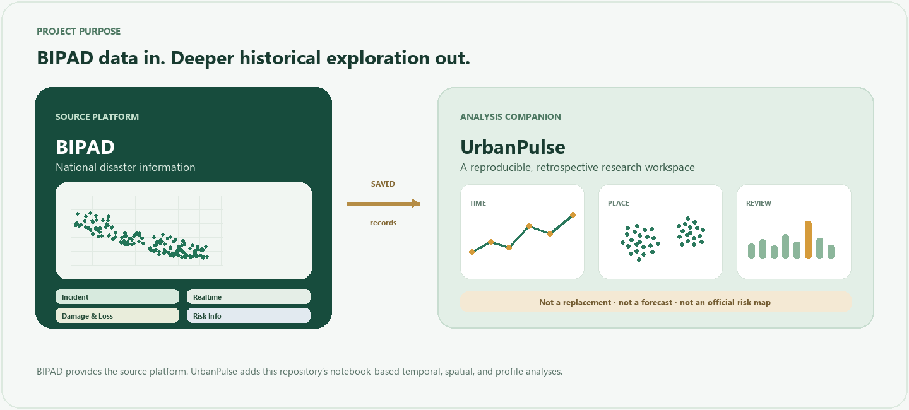

  

  
  
  

> **Goal:** Build a transparent, reproducible way to explore historical disaster reports from Nepal and identify patterns that deserve closer examination. The current product is exploratory; operational decisions remain with BIPAD and responsible authorities.

## Why this project exists

Historical incident records contain multiple dimensions—time, hazard, location, and administrative area. UrbanPulse brings those dimensions into one analysis workflow so a user can move from summary counts to specific periods, places, and records. The project also makes analytical choices visible: it compares parameter settings and documents where a method produces weak, imbalanced, or unverified results.

The intent is to support learning and evidence review. A change in recorded counts can reflect reporting practices, data coverage, or actual events; UrbanPulse cannot distinguish those explanations without additional verified data.

## Project objective

Create a notebook-backed analytical companion to BIPAD that:

1. Preserves the provenance and quality checks of a saved incident-data retrieval.
2. Summarizes reported activity over time, by hazard, and by municipality.
3. Explores spatial density and municipality profile groupings without labeling them as official risk zones.
4. Surfaces unusual municipality-month activity profiles as candidates for human review, not as alerts.
5. Presents the results in an interactive dashboard with filters, maps, and clear interpretation limits.
6. Makes the analysis reproducible and reviewable through ordered notebooks and saved artifacts.

## How UrbanPulse relates to BIPAD

BIPAD is the source system and a broader disaster information platform. Its public portal exposes incident maps and navigation for modules including Dashboard, Incident, Damage & Loss, Realtime, Profile, Risk Info, Data Archive, VisRisk, and IBF. Its public incident guidance describes map-based incident details and filtering. UrbanPulse does not claim these capabilities as new or unique.

| Dimension | BIPAD Portal | UrbanPulse in this repository |
|---|---|---|
| Primary role | National disaster information portal and source platform, with multiple operational and information modules | Focused, retrospective analysis of a saved set of BIPAD incident records |
| Data | BIPAD's portal data and modules, which may cover information beyond this project's local snapshot | Retrieved incident records plus saved administrative lookups and derived analytical artifacts |
| Main user task | Access BIPAD information and its portal modules, including incident and real-time views | Compare historical patterns and analysis settings using notebooks and dashboard filters |
| Analysis emphasized here | The comparison is not a claim about all BIPAD capabilities | Temporal summaries, Haversine DBSCAN parameter comparison, municipality profile clustering, and anomaly-candidate scoring |
| Map | BIPAD already provides incident mapping | Adds local exploratory layers for filtered saved records and analysis outputs; not a replacement map service |
| Alerts / response | BIPAD's portal includes real-time and other operational modules | No live alert feed, official risk score, response workflow, or forecast is implemented |
| Data lifecycle | BIPAD operates the source platform | This repository stores a dated retrieval; its completeness is currently unverified |

The distinction is the *analytical workflow implemented here*, not that BIPAD lacks maps, filters, dashboards, or other features. The BIPAD portal and module labels can evolve; consult the live [BIPAD Portal](https://bipadportal.gov.np/) and [BIPAD Incident page](https://bipadportal.gov.np/incidents/) for current source capabilities. The [BIPAD User Handbook](https://bipadportal.gov.np/media/bipad_user_handbook_P6ToNkB.pdf) describes incident maps and filters.

## What makes the project different

- **Analysis-first scope:** The workflow centers on retrospective questions and model diagnostics rather than source-system operation.
- **Multiple methods side by side:** Spatial density, municipality profiles, and anomaly candidates are evaluated as distinct tasks with their own limitations.
- **Sensitivity is visible:** Alternative DBSCAN radii and municipality-clustering configurations show how choices change outputs.
- **Human review stays in the loop:** The dashboard exposes records and candidate profiles for inspection; it does not turn scores into alerts or decisions.
- **Notebook-level traceability:** Acquisition, preprocessing, analysis, and findings are documented in sequence, with saved manifests and outputs.
- **Explicit coverage caveat:** The app reports what was retrieved and records uncertainty instead of presenting the snapshot as a complete national archive.

## Current project state

The saved snapshot `20261013T101245Z` contains 64,735 retrieved records, with observed incident dates from 14 April 2011 through 13 October 2026, 20 hazard categories, and reports mapped to 755 municipalities. The API's reported total was an implausible sentinel and retrieval stopped after an empty response on page 66. Therefore, archive completeness is **unverified**.

The analytical notebooks are complete through temporal pattern analysis, and the Streamlit dashboard visualizes the saved artifacts. Experiments have been run, but **no final clustering model has been selected**: DBSCAN outputs vary substantially with parameters; municipality partitions tested were imbalanced or weakly separated. Isolation Forest marks review candidates without ground-truth labels. **No supervised disaster forecast has been built or validated.**

See [README: methods and findings](README.md#methods-and-findings), the [saved model comparison](reports/model_comparison.csv), and the [data-quality report](data/processed/bipad_incidents/20261013T101245Z/data_quality_report.json).

## Workflow

1. Retrieve paginated incident and administrative records from the BIPAD public API.
2. Audit identifiers, dates, coordinates, and joins, then save a processed snapshot.
3. Compare exploratory spatial, municipality-profile, and anomaly methods.
4. Summarize temporal patterns and retain findings with each notebook.
5. Explore the saved data and analysis outputs in the dashboard.

The dashboard loads saved artifacts. It does not call the API or fit models on startup. Run the ordered notebook workflow in the [README](README.md#analysis-workflow) to refresh or reproduce artifacts.

## Intended users and use

UrbanPulse is intended for students, researchers, analysts, and reviewers who want to inspect the saved historical records and understand how exploratory methods behave. Suitable uses include:

- Exploring when and where reports occur in the retrieved snapshot.
- Comparing hazard and municipality report-count profiles.
- Checking how spatial or profile clusters change under different settings.
- Creating a shortlist of unusual municipality-month activity profiles for source review.
- Demonstrating an auditable data-analysis workflow.

It is not designed to direct emergency response, allocate resources, communicate public warnings, or establish the official hazard level of a place.

## Non-goals

- Replacing BIPAD, its source records, or its operational and information modules.
- Claiming that report concentration equals disaster risk, exposure, or severity.
- Forecasting the timing, location, or impact of future disasters.
- Treating unsupervised clusters as official boundaries or verified risk classes.
- Treating anomaly candidates as erroneous, abnormal, or dangerous events without validation.
- Claiming national archive completeness from the current saved retrieval.

## Conditions for expanding the goal

Future work should proceed only when its required evidence is available:

| Possible extension | Evidence required first |
|---|---|
| Stronger historical comparisons | Verified source coverage, stable field definitions, and documented changes in collection practices |
| Municipality comparisons as rates | Suitable exposure or population denominators aligned to place and time |
| Validated anomaly detection | Expert-reviewed labels, a review protocol, and independent evaluation |
| Forecasting | A defined future target and horizon, time-aligned predictors, leakage-safe temporal splits, prospective evaluation, and clear uncertainty reporting |
| Operational or warning use | Formal authority, reliability, monitoring, governance, and integration with approved response processes |

## Success criteria

The project is successful at its current stage when a user can:

1. Trace results to the saved source retrieval and its limitations.
2. Reproduce the notebook workflow and see findings in the notebook that generated them.
3. Explore reports by time, hazard, and municipality without confusing counts with risk.
4. Inspect how alternative method settings change exploratory outputs.
5. Tell clearly that the dashboard is not a forecast or official decision system.

## Project references

- [Project README](README.md)
- [BIPAD Portal](https://bipadportal.gov.np/)
- [BIPAD Incident page](https://bipadportal.gov.np/incidents/)
- [BIPAD public API](https://bipadportal.gov.np/api/)
- [BIPAD User Handbook](https://bipadportal.gov.np/media/bipad_user_handbook_P6ToNkB.pdf)
