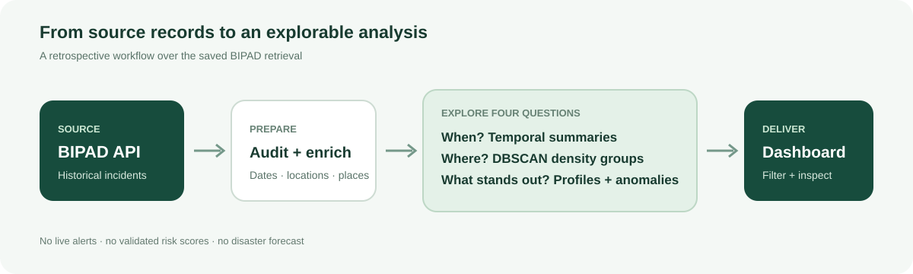
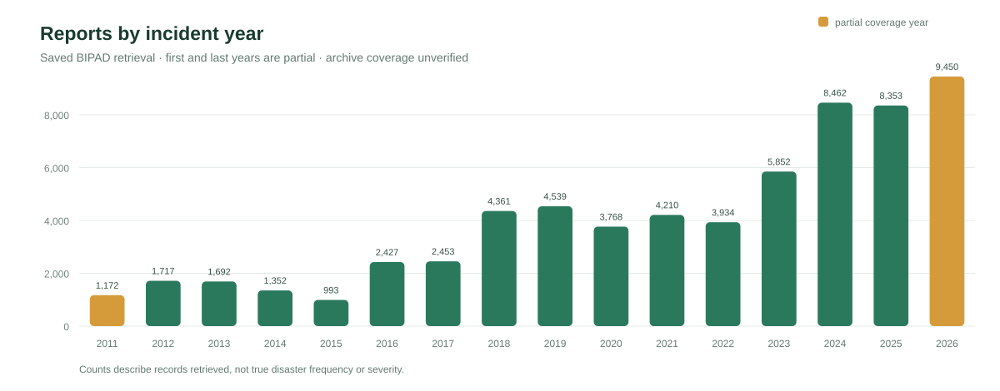

<p align="center">
  
</p>

<p align="center">
  
  
  
  
</p>

> **Project status: exploratory historical analysis + interactive dashboard**
>
> UrbanPulse works with a saved BIPAD incident retrieval. Its clusters and anomaly candidates are exploratory; it does not issue alerts, estimate official risk, or forecast disasters.

UrbanPulse Nepal makes historical incident reports easier to inspect across time, location, hazard, and municipality. The project combines a reproducible notebook workflow with a Streamlit dashboard. Its purpose is to help users explore patterns and formulate questions for source verification—not to replace BIPAD or disaster-management decisions.

**Quick links:** [Project goal](Project_Goal.md) · [Dashboard](#run-the-dashboard) · [Docker](#run-with-docker) · [Analysis workflow](#analysis-workflow) · [Limitations](#limits-and-responsible-use)

## At a glance

| Saved snapshot | Analysis | What the project adds |
|---|---|---|
| **64,735** incident records retrieved | Temporal summaries, spatial DBSCAN, municipality profile clustering, Isolation Forest candidates | Notebook-based comparison and sensitivity review alongside a filterable exploratory dashboard |
| **14 Apr 2011 – 13 Oct 2026** observed incident dates | 20 hazard categories; reports mapped to 755 municipalities | Historical, cross-method exploration of a saved snapshot |
| Pagination completeness **unverified** | No supervised forecast model | Explicit caveats so report patterns are not presented as risk or prediction |

The counts describe the saved retrieval identified as `20261013T101245Z`. BIPAD returned an invalid total-count sentinel, so 64,735 is the number retrieved in this run—not proof of a complete archive.

## Why UrbanPulse?

BIPAD is Nepal's disaster information portal, with its own incident mapping and broader operational modules such as real-time information, damage and loss, risk information, and data archive. UrbanPulse uses BIPAD incident records as its source and adds a focused analytical workflow to this repository: compare time patterns, test spatial-clustering settings, explore municipality profiles, and surface activity profiles for review. These are complementary research views; mapping and incident information are already part of BIPAD. See the [Project Goal](Project_Goal.md) for the scoped comparison and links to BIPAD's public portal.

## Analysis workflow

<p align="center">
  
</p>

Run notebooks 01–07 in numerical order. Each notebook records its findings at the end.

| Notebook | Purpose |
|---|---|
| [01 · BIPAD data acquisition](notebooks/01_bipad_data_acquisition.ipynb) | Retrieve paginated incident data and administrative lookups; save raw pages and manifests. |
| [02 · Data audit and preprocessing](notebooks/02_data_audit_and_preprocessing.ipynb) | Validate records and coordinates; derive dates and join municipality information. |
| [03 · DBSCAN spatial clusters](notebooks/03_dbscan_spatial_clusters.ipynb) | Compare Haversine distance and density parameters for incident locations. |
| [04 · Municipality clustering](notebooks/04_municipality_hierarchical_clustering.ipynb) | Compare hierarchical clustering of municipality hazard and seasonal profiles. |
| [05 · Activity anomaly candidates](notebooks/05_isolation_forest_activity_anomalies.ipynb) | Score municipality-month profiles for review under multiple settings. |
| [06 · Cross-method comparison](notebooks/06_cross_method_model_comparison.ipynb) | Summarize outputs and task-specific interpretation limits. |
| [07 · Temporal analysis](notebooks/07_temporal_pattern_analysis.ipynb) | Summarize annual, monthly, seasonal, and hazard counts. |

### Observed report counts

<p align="center">
  
</p>

This chart is generated from the saved annual-count output. Counts depend on reporting and retrieval coverage; they do not measure the true number or severity of disasters. The first and last observed years are partial.

## Methods and findings

The methods answer different exploratory questions. The saved outputs are in [`reports/model_comparison.csv`](reports/model_comparison.csv) and [`reports/model_comparison_summary.json`](reports/model_comparison_summary.json).

| Method | Example result | Reading the result |
|---|---|---|
| DBSCAN, 1 km / 10 minimum points | 1,019 clusters; 32.49% noise; largest cluster 1,244 | Fine-grained grouping; sample silhouette excludes noise and is not a risk metric. |
| DBSCAN, 5 km / 5 minimum points | 298 clusters; 0.99% noise; largest cluster 38,428 | Broad radius merges many records into one group. |
| Agglomerative, average / 3 groups | 726 municipalities; group sizes include 724 and 1 | High silhouette accompanies an extremely imbalanced split. |
| Agglomerative, Ward / 3 groups | 610 municipalities; group sizes 10–314; silhouette 0.097 | More balanced, but weak separation. No final segmentation selected. |
| Isolation Forest, 1% contamination | 283 of 28,202 active municipality-month profiles flagged | Review candidates only; no ground-truth labels to measure detection quality. |

No single model is selected as a winner. These methods are not trained disaster prediction models.

## Run the dashboard

Install dependencies from the project root:

```powershell
python -m venv .venv
.venv\Scripts\Activate.ps1
python -m pip install --upgrade pip
pip install -r requirements.txt
streamlit run dashboard.py
```

Open `http://localhost:8501`. The dashboard reads the saved processed records and analysis artifacts; it does not fetch BIPAD data or train models at startup. Sidebar filters select incident date, hazard name, and municipality. The sections cover overview charts, a Nepal map, trends, municipality profiles, anomaly candidates, model comparison, and data quality.

## Run with Docker

From the repository root:

```powershell
docker build -t urbanpulse-nepal .
docker run --rm -p 8501:8501 urbanpulse-nepal
```

Open `http://localhost:8501`. The image includes the saved project artifacts and dependencies in `requirements.txt`. Rebuild after changing application code or the data artifacts included in the image.

## Repository map

| Path | Contents |
|---|---|
| `dashboard.py` | Streamlit dashboard entry point |
| `notebooks/` | Acquisition, preprocessing, analysis, comparison, and findings |
| `data/raw/` | Saved BIPAD API responses, exports, and retrieval manifests |
| `data/processed/` | Audited records, features, clusters, anomaly scores, and summaries |
| `reports/` | Cross-method model comparison |
| `docs/assets/` | README and project-goal diagrams and data chart |
| `Dockerfile`, `.dockerignore` | Container build configuration |

## Limits and responsible use

- The API's total count was an implausible sentinel; completeness of the saved archive is unverified.
- Report counts reflect reporting and retrieval, not true incidence, exposure, or hazard risk.
- Municipality totals are not adjusted for population, exposure, reporting access, or changing completeness.
- Cluster assignments vary with method and settings. Current municipality clusters are either highly imbalanced or weakly separated.
- Isolation Forest has no ground-truth labels in this project. A candidate is not a confirmed anomaly or alert.
- Map markers are sampled for responsiveness; the dashboard's density layer uses all filtered coordinates. Basemap tiles require network access.
- Empty periods do not establish that no disaster occurred; the initial and final observed years are partial.

Do not use UrbanPulse alone for warnings, emergency response, resource allocation, or official risk decisions. Consult BIPAD and the responsible disaster-management authorities.

## Data source

- [BIPAD Portal](https://bipadportal.gov.np/)
- [BIPAD Incident page](https://bipadportal.gov.np/incidents/)
- [BIPAD public API](https://bipadportal.gov.np/api/)
- [BIPAD User Handbook](https://bipadportal.gov.np/media/bipad_user_handbook_P6ToNkB.pdf)

The saved incident source endpoint is `https://bipadportal.gov.np/api/v1/incident/`. Refer to the retrieval manifest and quality report for the exact snapshot provenance.
